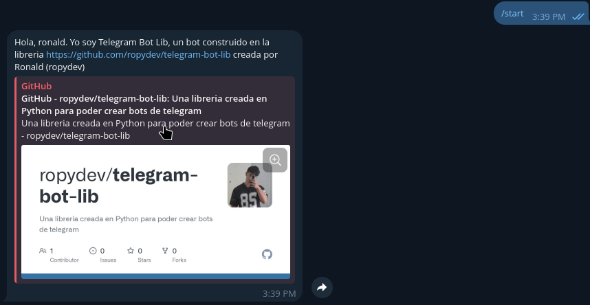
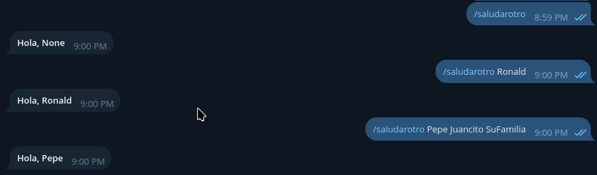
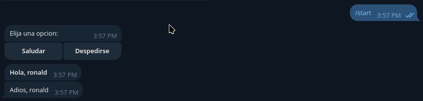
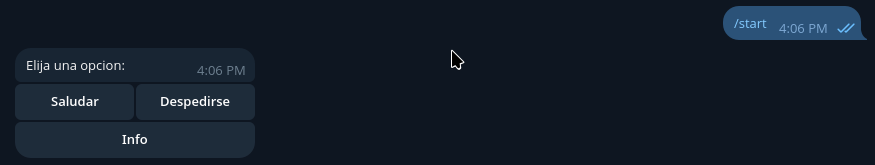
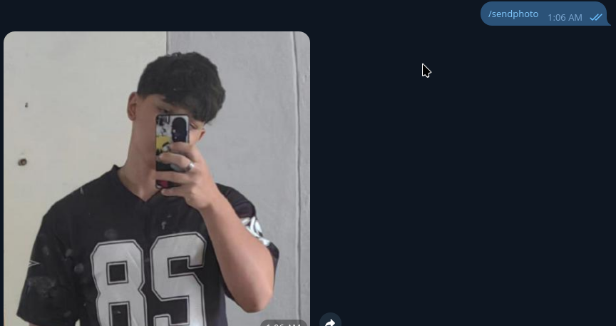
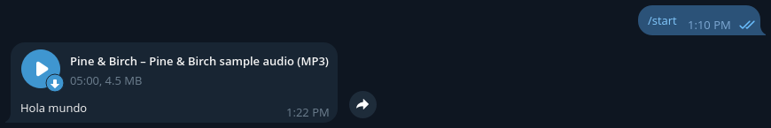
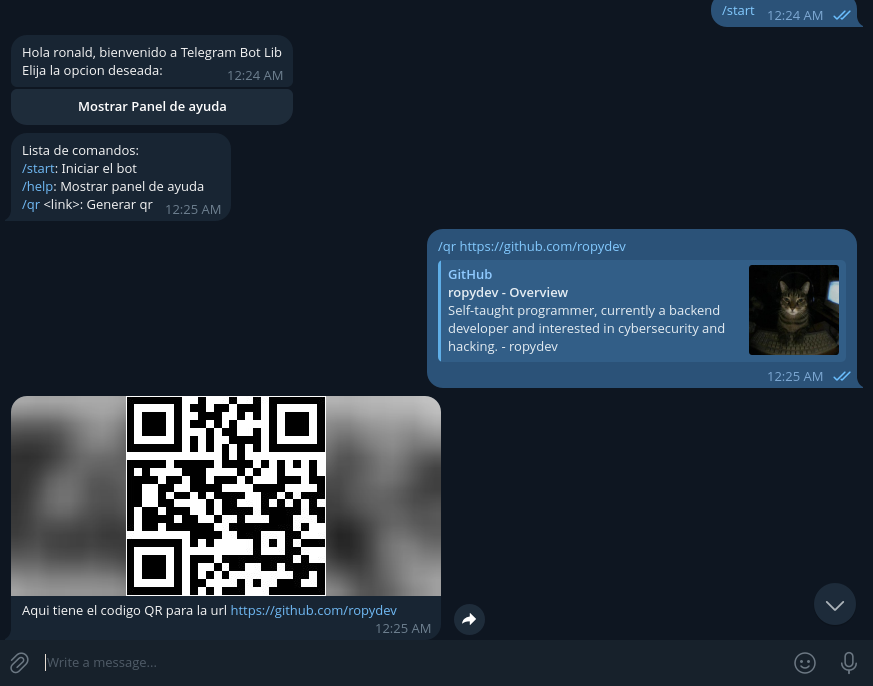

# TelegramBot

Una pequeña librería de Python para interactuar con la [Telegram Bot API](https://core.telegram.org/bots/api) mediante una interfaz orientada a objetos. Permite consultar la información del bot, enviar mensajes y tener un sistema de comandos.

> **Estado del proyecto:** versión inicial / en desarrollo.

## Características

- Obtener los datos del bot con `getInfo()`.
- Enviar mensajes de texto a un ID especifica.
- Crear botones inline con `buttons()` en un mensaje.
- Permite tener un sistema de comandos que permita interactuar con el bot

## Requisitos

- Python 3.9 o superior recomendado.
- Un bot de Telegram y su token.

## Instalación

```bash
git clone https://github.com/ropydev/telegram-bot-lib.git
cd telegram-bot-lib
pip install -r requirements.txt
```

## Crear un bot de Telegram

1. Abre Telegram y busca **@BotFather**.
2. Ejecuta `/newbot` y sigue las instrucciones.
3. Copia el token que BotFather te proporciona.

## Crear comandos

```python
from lib import telegramLib # Importa la libreria

bot = telegramLib.TelegramBot("TuToken") # Genera el bot


def start(ctx):
    bot.sendMessage(ctx.chat_id, f"Hola, {ctx.name}. Yo soy {ctx.botName}, un bot construido en la libreria https://github.com/ropydev/telegram-bot-lib creada por Ronald (ropydev)").send() # Crea la funcion del comando

commands = [
    ("/start", start) # Indica que el comando /start llamara a la funcion start()
]

bot.start("Bot iniciado", commands=commands) # Inicia el bot y le indica su lista de comandos
```

### Resultado



## Crear comandos con argumentos

```python
from lib import telegramLib # Importa la libreria

bot = telegramLib.TelegramBot("TuToken") # Genera el bot

def saludarOtro(ctx, name):
    bot.sendMessage(ctx.chat_id, f"<b>Hola, {name}</b>", parse_mode="HTML").send() # Mandar mensaje (necesita que el comando tenga un parametro, ejemplo: /saludarotro Ronald)

commands = [
    ("/saludarotro", saludarOtro) # Indica que el comando /start llamara a la funcion start()
]

bot.start("Bot iniciado", commands=commands) # Inicia el bot y le indica su lista de comandos
```
(La unica diferencia son los argumentos de la funcion del comando, ctx (el obligatorio) y los demas son libres (en caso de que el comando no reciba argumentos, se rellenaran con None, en caso de haber mas argumentos de los necesarios se obtendran los primeros n))

Ejemplos:



## Crear un mensaje con botones inline

El método `sendMessage(chat_id, text)` crea un objeto `Message`. Puedes encadenar `buttons()` y `send()`:

```python
from lib import telegramLib # importa la libreria

bot = telegramLib.TelegramBot("TuToken") # Generar bot

def saludar(ctx):
    bot.sendMessage(ctx.chat_id, f"<b>Hola, {ctx.name}</b>", parse_mode="HTML").send() # Mandar mensaje en HTML

def despedirse(ctx):
    bot.sendMessage(ctx.chat_id, f"Adios, {ctx.name}").send() # Mandar mensaje

def start(ctx):
    buttons = [
        ("Saludar", saludar),
        ("Despedirse", despedirse)
    ] # indicador de botones y sus funciones

    bot.sendMessage(ctx.chat_id, "Elija una opcion:").buttons(buttons).send() # Mensaje con botones

commands = [
    ("/start", start)
] # indicador de comandos

bot.start("Bot iniciado", commands=commands) # inicia el bot e indica sus comandos
```

### Resultado




## Organizar los botones en varias filas

Cada llamada a `buttons()` agrega una nueva fila al teclado:

```python
from lib import telegramLib # importa la libreria

bot = telegramLib.TelegramBot("TuToken") # Generar bot

def saludar(ctx):
    bot.sendMessage(ctx.chat_id, f"<b>Hola, {ctx.name}</b>", parse_mode="HTML").send() # Mandar mensaje en HTML

def despedirse(ctx):
    bot.sendMessage(ctx.chat_id, f"Adios, {ctx.name}").send() # Mandar mensaje

def info(ctx):
    bot.sendMessage(ctx.chat_id, f"Nombre: {ctx.name}\nUsername: {ctx.username}").send() # Mandar Info

def start(ctx):
    buttons = [
        ("Saludar", saludar),
        ("Despedirse", despedirse)
    ] # indicador de botones y sus funciones
    buttons1 = [
        ("Info", info)
    ] # otra fila de botones

    bot.sendMessage(ctx.chat_id, "Elija una opcion:")\
        .buttons(buttons)\
            .buttons(buttons1).send() # Mensaje con botones

commands = [
    ("/start", start)
] # indicador de comandos

bot.start("Bot iniciado", commands=commands) # inicia el bot e indica sus comandos
```

### Resultado



## Enviar una imagen atravez de un link

```python
from lib import telegramLib
import requests

bot = telegramLib.TelegramBot("TuToken")

def sendPhoto(ctx):
    bot.sendPhoto(ctx.chat_id, "https://avatars.githubusercontent.com/u/291429318?v=4").send()


commands = [
    ("/sendphoto", sendPhoto)
]
bot.start("Bot iniciado", commands=commands)
```

### Resultado:



(tambien se le pueden atribuir botones y todo lo de los botones)

## Enviar un audio atravez de un link
```python
from lib import telegramLib # importa la libreria

bot = telegramLib.TelegramBot("TuToken") # conecta el bucle

def start(ctx):
    bot.sendAudio(ctx.chat_id, "https://pnb-freetoolsforweb.s3.us-east-2.amazonaws.com/samples/audio/mp3/sample-audio-5min-128kbps.mp3", "Hola mundo").send() # crea y envia el mensaje

commands = [
    ("/start", start) # establece la funcion start para el comando /start
]
bot.start("Bot iniciado", commands=commands) # inicia el bot
```

### Resultado



La clase a la que pertenece el metodo sendAudio es hija de la clase Message (al igual que el metodo message y el metodo sendPhoto) asi que comparten el metodo buttons y send y permite que los audios, imagenes y mensajes tengan botones de la misma manera

## Usar el contexto

Las funciones reciben un objeto `ctx` de tipo `CallbackContext` o `CommandContext`. Este objeto contiene información de la pulsación o comando, informacion del usuario y métodos auxiliares.

### ctx.bot
Comunicarse con el bot y sus metodos
Ejemplo:
```python
def sendMessage(ctx):
    ctx.bot.sendMessage("Hola").send()
```

### ctx.chat_id
Obtener el id del chat al q se le hizo la peticion
Ejemplo:
```python
def idMsg(ctx):
    bot.sendMessage(f"El id del chat es {ctx.chat_id}")

# Salida:
#    Bot: El id del chat es 192837465
```

### ctx.user_id
Obtener el id del usuario q hizo la peticion
Ejemplo:
```python
def idMsg(ctx):
    bot.sendMessage(f"Su id es {ctx.user_id}")
```

### ctx.username
Obtener el username del usuario q hizo la peticion
Ejemplo:
```python
def username(ctx):
    bot.sendMessage(f"Su id es {ctx.username}")
```

### ctx.name
Obtener el nombre del usuario q hizo la peticion
Ejemplo:
```python
def name(ctx):
    bot.sendMessage(f"Hola {ctx.username}")
```

## Funciones
### `TelegramBot(token)`

Crea el bot y obtiene sus datos usando `getMe`.

Propiedades:

- `bot.url`: URL base de la Bot API.
- `bot.id`: identificador numérico del bot.
- `bot.name`: nombre visible del bot.
- `bot.username`: nombre de usuario del bot.

### `bot.getInfo()`

Devuelve el objeto con la información del bot que entrega el método `getMe` de Telegram.

### `bot.sendMessage(chat_id, text).send()`

Crea un objeto `Message` para construir y enviar un mensaje con teclado inline opcional y envia el mensaje.

### `bot.sendMessage(chat_id, text).buttons([])`

Le apropia botones a un mensaje de la forma [ ("Texto del Boton", funcion), ("def", funcion) ]

### `bot.sendMessage(...).send()`

Envía el mensaje y su teclado, si lo hay.

### `bot.sendPhoto(chat_id, photo, caption)`

Crea un objeto el cual permite enviar una imagen atravez de un link publico

### `bot.sendPhoto(...).buttons([()])`

Permite agregarle botones al mensaje de la imagen (funciona exactamente igual a los de los mensajes (comparten la clase Message))

### `bot.sendPhoto(...).send()`

Permite enviar la imagen

### `bot.sendAudio(chat_id, audio, caption)`

Crea un objeto de Audio

### `bot.sendAudio(...).buttons([()])`

Permite agregarle botones al mensaje del audio (funciona exactamente igual a los de los mensajes (comparten la clase Message))

### `bot.sendAudio(...).send()`

Envia el audio (con botones si los tiene)

### `bot.start(message, commands=[])`

Inicia el bucle del bot, recibe el argumento message (el mensaje q se imprime en consola cuando se inicia el bot) y commands (un array q contiene los comandos y sus funciones)

Ejemplo de array de comandos: [("/start", start), ("/help", helpMsg)]

## Ejemplos de bots funcionales (el main.py se debe encontrar en la raiz del proyecto)

### Generador de codigos QR
```python
from lib import telegramLib
import requests

bot = telegramLib.TelegramBot("TuToken")

def start(ctx):
    bot.message(ctx.chat_id, f"Hola {ctx.name}, bienvenido a {ctx.botName}\nElija la opcion deseada:")\
        .buttons([("Mostrar Panel de ayuda", helpMsg)]).send()

def helpMsg(ctx):
    bot.message(ctx.chat_id, f"Lista de comandos:\n/start: Iniciar el bot\n/help: Mostrar panel de ayuda\n/qr <link>: Generar qr")\
        .send()

def genQr(ctx, url):
    params = {
        "size": "200x200",
        "data": url
    }
    response = requests.get("https://api.qrserver.com/v1/create-qr-code/", params=params)
    bot.sendPhoto(ctx.chat_id, response.url, f"Aqui tiene el codigo QR para la url {url}")\
        .buttons([("Back", start)])\
        .send()

commands = [
    ("/start", start),
    ("/help", helpMsg),
    ("/qr", genQr)
]
bot.start("Bot iniciado", commands=commands)
```

Resultado:

